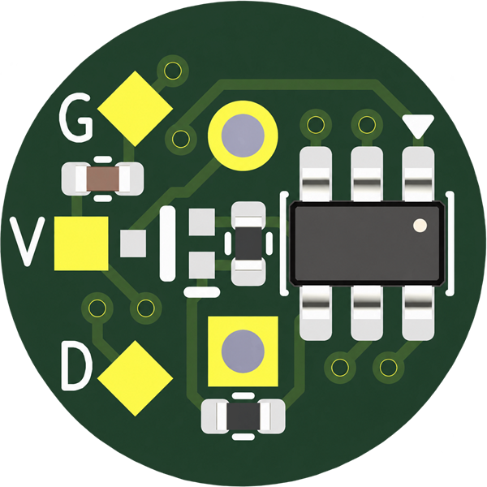

# 機体発見アラーム (LAlarm)

直径 φ10 mm・重さ 1 g の、超小型・軽量の機体発見アラームです。
1 分ごとに分報（5 分後なら 5 回「ピーッ」）が鳴り、7 分後からアラームが鳴り続けます。

**[説明ページ](https://westisland.jp/lalarm/)**

## 基板

| 表 | 裏 |
|---|---|
|  |  |

## フォルダ

- `LALARM/` … 基板 (KiCad)
- `LALARM.X/` … PIC10F202 のプログラム (MPLAB X / XC8)

## 接続

- K110S: B+ と B- に接続
- それ以外の機体: S.BUS のコネクタなどに接続

[にしやん工房](https://westisland.jp/)
